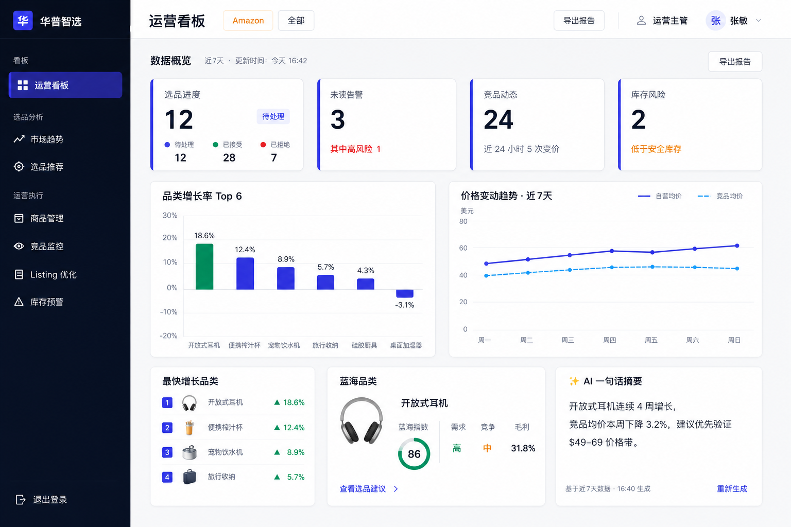
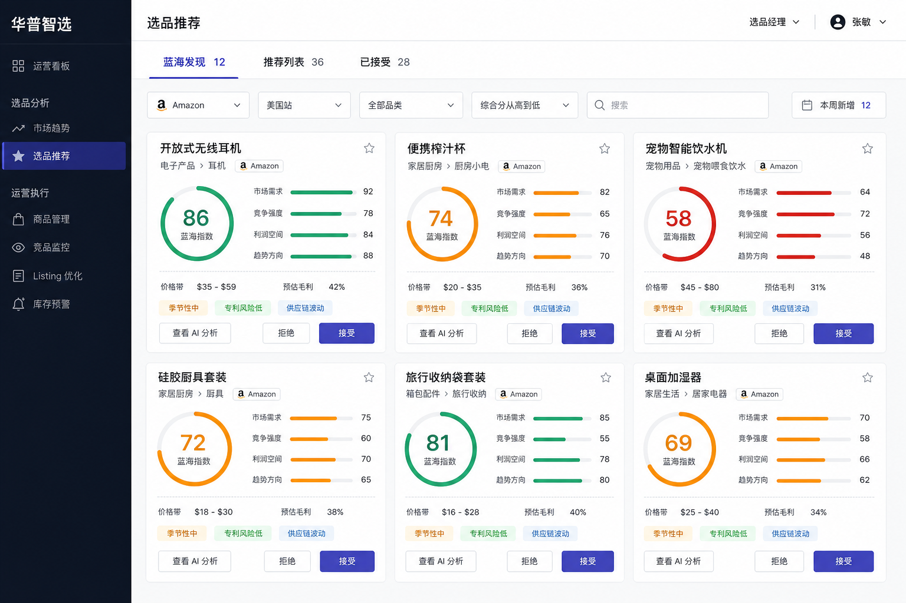
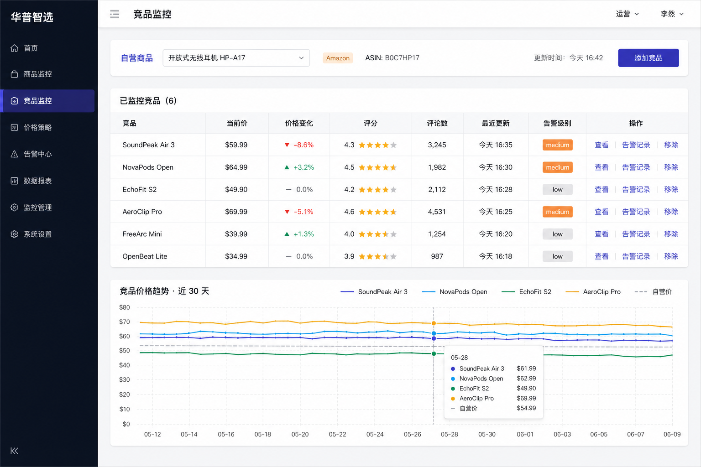

# 华普智选 · 智能选品与跨境运营中台

> 数据驱动选品 + AI 自动化运营：帮跨境团队把人均可管 SKU 从约 10 个提升到 50+。

华普智选面向跨境电商运营团队，覆盖 **Amazon / Shopee** 品类数据采集、市场趋势、AI 蓝海选品、竞品告警、Listing 优化与运营看板，提供 FastAPI 后端与 Vue 3 运营工作台。

设计与契约依据：[docs/PRD.md](docs/PRD.md) · [docs/SDD.md](docs/SDD.md) · [docs/DESIGN-SIGNOFF.md](docs/DESIGN-SIGNOFF.md)

---

## 技术架构

```
┌──────────────────────────────────────────────────────────────────┐
│  Vue 3 + Vite + Element Plus + Pinia + ECharts                    │
│  AppShell（侧栏 7 菜单）· 登录/注册 · 7 业务页                     │
└───────────────────────────────┬──────────────────────────────────┘
                                │ HTTPS / JWT  Bearer
┌───────────────────────────────▼──────────────────────────────────┐
│  FastAPI  /api/v1                                                 │
│  routers → services → models（SQLAlchemy 2.0）                    │
│  ┌─────────────┐  ┌──────────────┐  ┌─────────────────────────┐  │
│  │ ARQ Worker  │  │ Redis 缓存   │  │ LLM（OpenAI 兼容）      │  │
│  │ 日批选品等  │  │ 会话/队列    │  │ mock / 千问 / DeepSeek  │  │
│  └─────────────┘  └──────────────┘  └─────────────────────────┘  │
└───────────────────────────────┬──────────────────────────────────┘
                                │
              ┌─────────────────▼─────────────────┐
              │  PostgreSQL 15（开发可用 SQLite）  │
              └─────────────────┬─────────────────┘
                                │
              ┌─────────────────▼─────────────────┐
              │  数据源：Mock / DummyJSON /        │
              │  Amazon SP-API / Shopee Open API  │
              └───────────────────────────────────┘
```

| 层 | 技术 |
|----|------|
| 前端 | Vue 3 · Vite · TypeScript · Element Plus · Pinia · ECharts |
| 后端 | FastAPI · Python 3.11+ · SQLAlchemy 2.0 · Pydantic v2 |
| 数据 | PostgreSQL 15 · Redis · ARQ |
| AI | OpenAI 兼容 API（`LLM_MODE=mock` 默认） |
| 部署 | Docker Compose（api / worker / db / redis / frontend） |

---

## 功能清单（6 个模块）

| 模块 | 能力 | 主要页面 / API |
|------|------|----------------|
| **一 · 数据接入与商品管理** | 品类/商品同步、搜索分页、价格历史、采集配置 | `/products` · `GET /api/v1/products*` · `/sync*` |
| **二 · 市场趋势分析** | 月度价格分位、增长率、季节性、AI 趋势报告 | `/trends` · `GET /api/v1/trends*` |
| **三 · 智能选品推荐** | 四维打分、蓝海发现、接受/拒绝、日批扫描 | `/recommendations` · `/api/v1/recommendations*` |
| **四 · 竞品监控与预警** | 竞品发现、价格快照、降价/评分告警 | `/competitors` · `/api/v1/competitors*` · `/alerts*` |
| **五 · AI Listing 优化** | 关键词挖掘、AI 文案、版本对比/采纳、A/B | `/listing` · `/api/v1/listing*` |
| **六 · 运营看板与部署** | 综合 KPI、库存预警、销量预测、Docker | `/` · `/inventory-alerts` · `/dashboard*` · `/inventory*` |

详细接口契约见 [docs/SDD.md](docs/SDD.md) §3。

---

## 快速开始（5 步）

> 以下为本地开发路径（后端 + 前端分离）。Docker 一键部署见文末。

### 1. 克隆并准备环境变量

```bash
cd smart-selection
cp .env.example .env
```

编辑 `.env`：至少设置非空 `SECRET_KEY`；本地可用默认：

```env
APP_ENV=development
DEBUG=true
DB_TYPE=sqlite
SECRET_KEY=dev-only-change-me-please-use-a-long-random-string
REDIS_HOST=127.0.0.1
REDIS_PORT=6379
CORS_ORIGINS=http://localhost:5173,http://127.0.0.1:5173
LLM_MODE=mock
DATA_SOURCE=dummyjson
```

需本机可用 **Redis**（登录防爆破 / 会话缓存；未连通时部分能力降级）。

### 2. 启动后端

```bash
cd backend
python -m venv .venv

# Windows PowerShell
.\.venv\Scripts\Activate.ps1
# macOS / Linux
# source .venv/bin/activate

pip install -r requirements.txt
uvicorn app.main:app --reload --host 0.0.0.0 --port 8000
```

启动后会自动建表并种子管理员（见下方账号）。

### 3. 启动前端

新开终端：

```bash
cd frontend
npm install
npm run dev
```

默认打开 [http://localhost:5173](http://localhost:5173)（Vite 已将 `/api` 代理到 `8000`）。

### 4. 登录系统

| 字段 | 值 |
|------|-----|
| 邮箱 | `zhangsan@126.com` |
| 初始密码 | `Zs123456` |

首次登录后请尽快修改密码（生产环境务必更换）。

### 5. 打开 API 文档并验收健康检查

- Swagger UI：[http://localhost:8000/docs](http://localhost:8000/docs)
- ReDoc：[http://localhost:8000/redoc](http://localhost:8000/redoc)
- 存活：`GET http://localhost:8000/api/v1/health`
- 就绪：`GET http://localhost:8000/api/v1/ready`

可选：另开终端启动 ARQ Worker（日批选品扫描）：

```bash
cd backend
arq app.workers.settings.WorkerSettings
```

---

## API 文档

| 入口 | 说明 |
|------|------|
| [http://localhost:8000/docs](http://localhost:8000/docs) | Swagger（交互调试，支持 Authorize 持久化 JWT） |
| [http://localhost:8000/redoc](http://localhost:8000/redoc) | ReDoc |
| [docs/SDD.md](docs/SDD.md) | 模块 API 契约、数据模型、数据流 |
| OpenAPI JSON | [http://localhost:8000/openapi.json](http://localhost:8000/openapi.json) |

统一前缀：`/api/v1` · 鉴权：`Authorization: Bearer <JWT>`（登录/注册/健康检查除外）  
统一响应：`{"code": 200, "data": ..., "message": "ok"}`

---

## 项目截图

> 高保真原型（桌面 1440×900），源文件位于 [`docs/prototypes/images/`](docs/prototypes/images/)。

### 运营看板



### 选品推荐



### 竞品监控



更多原型索引见 [docs/prototypes/README.md](docs/prototypes/README.md)。

---

## Docker 一键部署（可选）

```bash
cp .env.example .env
# 修改 SECRET_KEY、POSTGRES_PASSWORD（生产禁止使用占位值）

docker compose up -d --build
```

| 服务 | 地址 |
|------|------|
| 前端（Nginx） | http://localhost |
| API | http://localhost:8000 |
| Swagger | http://localhost:8000/docs |

编排说明见 [docs/SDD.md §5.4](docs/SDD.md#54-docker-部署模块六) · 配置项见 [.env.example](.env.example)。

---

## 文档索引

| 文档 | 职责 |
|------|------|
| [docs/PRD.md](docs/PRD.md) | 产品需求与 Must/Should 验收 |
| [docs/SDD.md](docs/SDD.md) | 数据模型、API、数据流、部署 |
| [docs/DESIGN.md](docs/DESIGN.md) | 视觉规范 |
| [docs/INTERACTION.md](docs/INTERACTION.md) | 交互与三态 |
| [docs/COMPONENT-SPEC.md](docs/COMPONENT-SPEC.md) | 组件规格 |
| [docs/DESIGN-SIGNOFF.md](docs/DESIGN-SIGNOFF.md) | 设计签收 |
| [CLAUDE.md](CLAUDE.md) | AI / 研发协作约定 |
| [progress.md](progress.md) | 实现进度 |
| [docs/decisions.md](docs/decisions.md) | 设计决策（DD） |

---

## License

内部项目 / 按团队约定使用。
