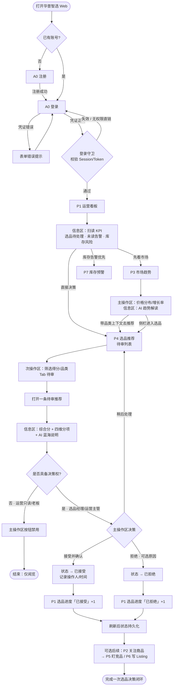
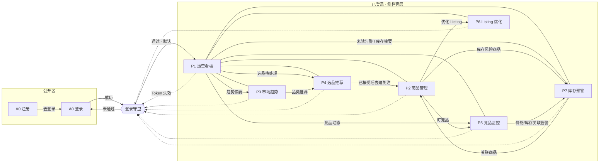
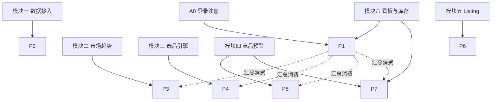
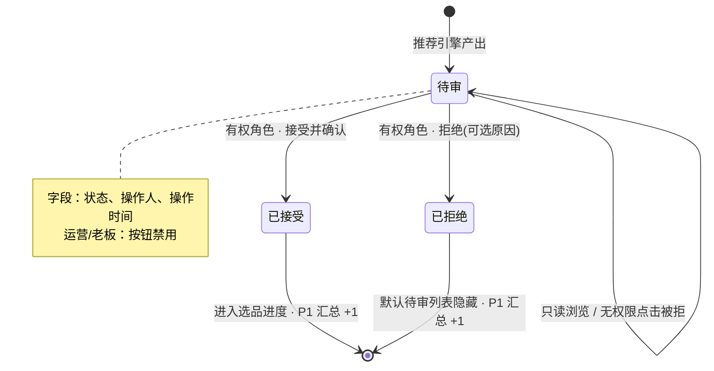
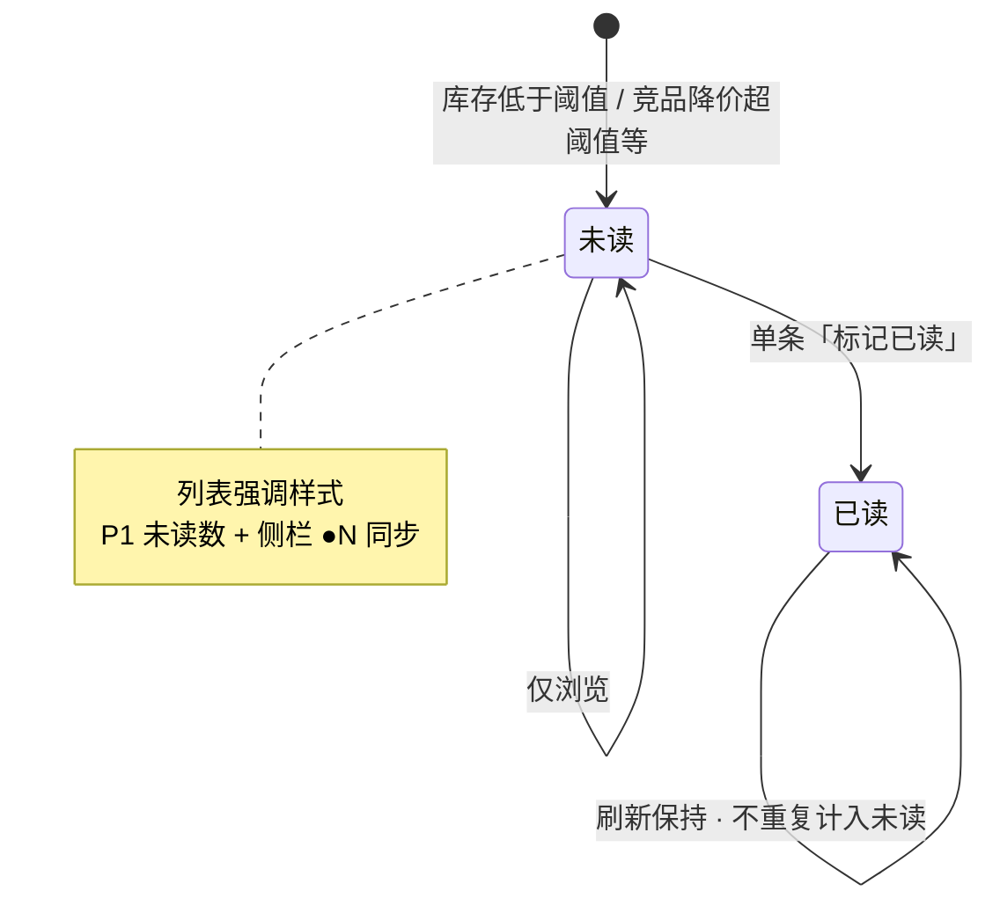
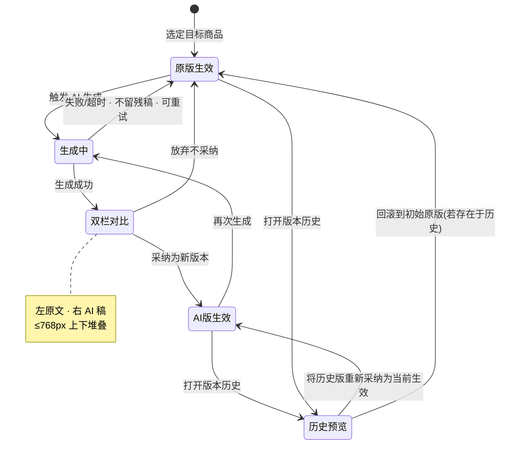
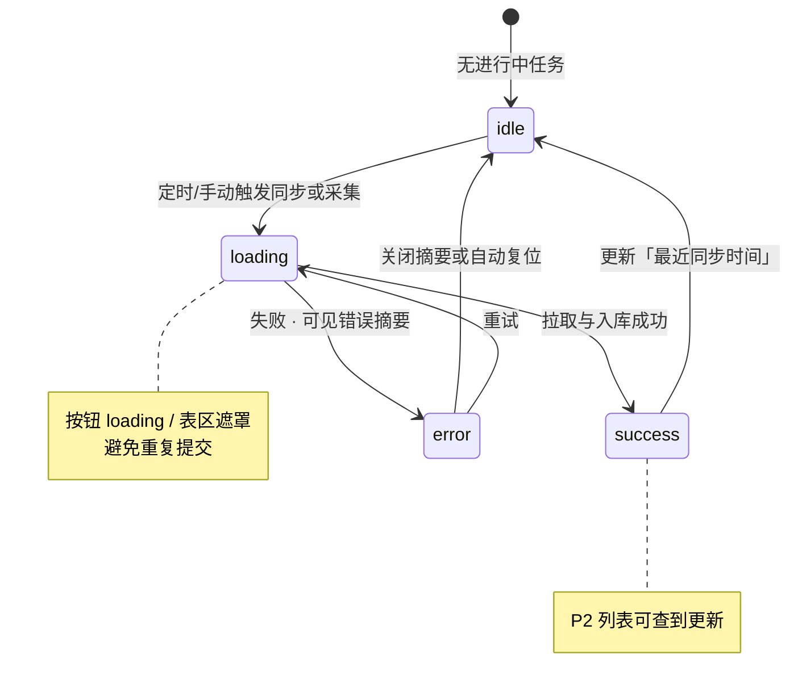

# 华普智选 — 业务流程与信息架构（FLOWS.md）

> 产品：华普智选（智能选品与跨境运营中台）  
> 版本：v1.1  
> 配套文档：`docs/PRD.md`（做什么）、`docs/DESIGN.md`（长什么样）、本文（怎么走）  
> 范围：用户旅程、页面跳转、导航与面包屑、模块映射、关键状态机、各页三区 ASCII 线框  
> **不含视觉原型图 / 高保真稿**

---

## 0. 页面总览（本文件采用的 8 页）

| 编号 | 页面 | 路由建议 | 说明 |
|------|------|----------|------|
| A0 | 登录 / 注册 | `/login` · `/register` | 鉴权入口；未登录唯一可达页（除公开落地占位） |
| P1 | 运营看板 | `/dashboard` | 全局 KPI 与跳转枢纽 |
| P2 | 商品管理 | `/products` | 商品库、搜索筛选、同步状态入口 |
| P3 | 市场趋势 | `/trends` | 品类价格分布、增长、AI 解读 |
| P4 | 选品推荐 | `/recommendations` | 四维打分、接受 / 拒绝决策 |
| P5 | 竞品监控 | `/competitors` | 竞品绑定、价格涨跌、关联告警处理 |
| P6 | Listing 优化 | `/listing` | 原文 / AI 稿双栏、版本采纳与回滚 |
| P7 | 库存预警 | `/inventory-alerts` | 库存风险列表、未读告警、阈值与处理 |

**与 PRD v1.1 页面编号对照（实现时以本表信息架构为准，能力不丢）：**

| 本文件 | PRD 对应 | 能力归属说明 |
|--------|----------|--------------|
| A0 登录/注册 | （隐含鉴权） | 新增注册；登录守卫 |
| P1 运营看板 | PRD P1 | 一致；库存摘要点击进 P7 |
| P2 商品管理 | PRD P2 | 一致；采集任务配置可挂本页次操作或设置抽屉 |
| P3 市场趋势 | PRD P3 | 一致 |
| P4 选品推荐 | PRD P4 智能选品 | 一致 |
| P5 竞品监控 | PRD P5 + 部分 P6 | 竞品降价告警可在本页处理或跳 P7 |
| P6 Listing 优化 | PRD P7 | 一致 |
| P7 库存预警 | PRD P1 Should 库存摘要 + 告警能力收敛 | 承接未读→已读状态机；销量/库存风险专页 |

> PRD 原「P8 数据采集配置」能力：MVP 收敛到 **P2 次操作区（同步/采集入口）** 或运营看板信息区摘要，不单独占侧栏一级（避免与本 8 页冲突）。

---

## 1. Mermaid 用户旅程图

> **主角：** 运营（日常跟品角色）。  
> **决策权限：** 按 PRD §5，接受/拒绝写操作归属 **选品经理 / 运营主管**；运营可走完阅览路径，决策节点若无权限则按钮禁用（S-05）。下图主路径按「具备决策权的运营侧账号（选品经理）」画完整闭环；虚线为只读分流。



### 1.1 旅程步骤 × PRD 验收

| 步骤 | 对应验收 | 级别 |
|------|----------|------|
| 登录进入看板 | 鉴权 + 默认落地 P1 | Must |
| 打开待审推荐 | S-01 可见四维与 AI 说明 | Must |
| 接受并确认 | S-02 已接受 + 操作人时间 + P1 +1 | Must |
| 拒绝 | S-03 已拒绝 + 待审列表默认隐藏 | Must |
| 刷新不回退 | S-04 | Must |
| 无决策权禁用 | S-05 | Must |
| 趋势 → 推荐带品类 | X-03 | Should |
| 看板 → 选品待处理 | X-02 | Must |

---

## 2. Mermaid 页面跳转关系图（8 页 + 登录守卫）



### 2.1 跳转边明细

| 从 | 到 | 触发 | 落地行为 |
|----|----|------|----------|
| 任意受保护页 | A0 登录 | 守卫失败 | 附 `returnUrl`，登录后回跳 |
| A0 登录 | P1 | 登录成功且无 returnUrl | 默认运营看板 |
| A0 注册 | A0 登录 | 注册成功 | 提示去登录（或自动登录进 P1） |
| P1 | P4 | 点击选品待处理 KPI | Tab=待审 |
| P1 | P7 | 点击未读告警 / 库存预警 KPI | 筛选未读 |
| P1 | P5 | 点击竞品动态 | 监控列表 |
| P1 | P3 | 点击趋势摘要 | 默认近窗品类 |
| P3 | P4 | 「查看相关推荐」 | query 带品类 ID |
| P2 | P5 / P6 / P7 | 行内操作 | 带商品 ID |
| P5 | P7 | 关联告警 | 定位告警行 |
| P4 | P2 | 接受后「去关注商品」 | 可选 |

### 2.2 登录守卫规则

```
访问受保护路由
├─ 无 Token / Session     → 重定向 /login?returnUrl=…
├─ Token 过期             → 清本地态 → /login
├─ 已登录但角色不可见该页 → 隐藏侧栏项；直链 → 403 或回 /dashboard
└─ 已登录且可读           → 放行；写按钮按角色禁用
```

注册页：仅未登录可访问；已登录访问注册则重定向 P1。

---

## 3. 左侧导航结构 + 面包屑规则

### 3.1 侧栏信息架构

```
华普智选
│
├─ 看板
│   └─ 运营看板 ........................ P1
│
├─ 选品分析
│   ├─ 市场趋势 ........................ P3
│   └─ 选品推荐 ........................ P4
│
├─ 运营执行
│   ├─ 商品管理 ........................ P2
│   ├─ 竞品监控 ........................ P5
│   ├─ Listing 优化 .................... P6
│   └─ 库存预警 ●N ..................... P7   （●N = 未读数）
│
└─ （账号区 · 侧栏底）
    └─ 退出登录 → 清 Session → A0
```

对齐 DESIGN §5.8 分组语义：看板 · 选品分析 · 运营执行；本 IA 无独立「系统配置」一级时，采集/阈值入口放在 P2 次操作或 P7 筛选旁的设置抽屉。

### 3.2 角色 × 导航可见性（映射 PRD §5.1）

| 导航项 | 运营 | 选品经理 | 运营主管 | 老板 |
|--------|:----:|:--------:|:--------:|:----:|
| P1 运营看板 | 显示 | 显示 | 显示 | 显示 |
| P3 市场趋势 | 显示 | 显示 | 显示 | 显示 |
| P4 选品推荐 | 显示（决策禁用） | 显示 | 显示 | 显示（决策禁用） |
| P2 商品管理 | 显示 | 显示 | 显示 | 隐藏 |
| P5 竞品监控 | 显示 | 显示 | 显示 | 隐藏 |
| P6 Listing 优化 | 显示 | 显示 | 显示 | 隐藏 |
| P7 库存预警 | 显示 | 显示 | 显示 | 隐藏* |

\* 老板若只需看库存态势，可通过 P1 摘要只读；MVP 可不暴露 P7 侧栏项。

### 3.3 面包屑规则

**格式：**

```
{一级分组} / {页面名称}[ / {上下文实体名}]
```

**规则：**

1. 一级分组与侧栏一致：`看板` · `选品分析` · `运营执行`。
2. 列表页两级即可，例如：`运营执行 / 商品管理`。
3. 打开详情抽屉或进入实体上下文时追加第三级，标题超过 20 字截断加省略号。
4. 跨页带来的筛选条件用页内 Tag 表达，**不写入面包屑**。
5. A0 登录/注册：无侧栏、无面包屑。
6. 中间级可点击返回列表；末级（当前）不可点。

| 页面 | 默认面包屑 | 带上下文示例 |
|------|------------|--------------|
| P1 | 看板 / 运营看板 | — |
| P2 | 运营执行 / 商品管理 | … / 商品管理 / B0XXX · 无线耳机… |
| P3 | 选品分析 / 市场趋势 | … / 市场趋势 / Home · Kitchen |
| P4 | 选品分析 / 选品推荐 | … / 选品推荐 / {品类名} |
| P5 | 运营执行 / 竞品监控 | … / 竞品监控 / {自营商品名} |
| P6 | 运营执行 / Listing 优化 | … / Listing 优化 / {商品名} |
| P7 | 运营执行 / 库存预警 | … / 库存预警 / {SKU/商品名} |
| A0 | — | — |

---

## 4. 6 模块与 8 页面映射表

| 模块 | 模块名称 | 主要承载页面 | 关联页面 | 回答的问题 |
|------|----------|--------------|----------|------------|
| 模块一 | 数据接入与商品管理 | **P2** 商品管理 | P1（同步摘要）、P7（缺货关联） | 商品数据是否就绪 |
| 模块二 | 市场趋势分析 | **P3** 市场趋势 | P1（趋势摘要）、P4（带品类跳转） | 什么好卖、品类增减 |
| 模块三 | 智能选品推荐引擎 | **P4** 选品推荐 | P1（选品进度）、P2（关注落地） | 我应该卖什么 |
| 模块四 | 竞品监控与预警 | **P5** 竞品监控 | P7（告警已读）、P1（竞品动态） | 竞品在干什么 |
| 模块五 | AI Listing 优化 | **P6** Listing 优化 | P2（选品入口） | Listing 怎么写 |
| 模块六 | 运营看板与部署 | **P1** 运营看板、**P7** 库存预警 | A0（交付访问入口） | 全局态势与库存风险 |



---

## 5. 关键状态机

### 5.1 选品推荐：待审 → 已接受 / 已拒绝



| 状态 | 默认列表可见 | 可执行动作 | 副作用 |
|------|--------------|------------|--------|
| 待审 | 是（待审 Tab） | 接受 / 拒绝（有权） | — |
| 已接受 | 已接受视图 / 进度 | 只读备注（Should） | P1「已接受」+1 |
| 已拒绝 | 默认否；可筛「已拒绝」 | 只读 | P1「已拒绝」+1 |

**MVP 不可逆：** 已接受 / 已拒绝不回退为待审。

---

### 5.2 告警：未读 → 已读

> 告警实体以 **P7 库存预警** 为主列表；竞品降价类告警可在 P5 露出入口并跳转 P7 统一标记已读（角标挂在侧栏「库存预警」）。



| 状态 | UI | 计数 |
|------|-----|------|
| 未读 | 左侧强调条 / 加粗 | 计入 P1 KPI 与侧栏角标 |
| 已读 | 常规行样式 | 不计入未读 |

**MVP 不做：** 已读改回未读；「全部已读」为 Could。

---

### 5.3 Listing：原版 ↔ AI 版 ↔ 历史版本回滚



| 状态 | 含义 | 主操作 |
|------|------|--------|
| 原版生效 | 当前生效为原文 | 生成优化 |
| 生成中 | 请求中 | 骨架屏；禁止采纳残缺稿 |
| 双栏对比 | 草稿未生效 | 采纳 / 放弃 / 重试 |
| AI版生效 | 新版本写入且为当前 | 再生成 / 看历史 |
| 历史预览 | 浏览历史版本 | 采纳该版本（回滚） |

**不变式：** 失败不覆盖原文；版本记录生成时间与操作人（Should）。

---

### 5.4 数据同步：idle → loading → success / error



| 状态 | 展现位置 | 用户可做 |
|------|----------|----------|
| idle | P2 同步时间 / 状态点 | 手动触发同步 |
| loading | 按钮与行状态「同步中」 | 等待 |
| success | 成功语义色 | 继续浏览 |
| error | 错误摘要 + 重试 | 重试 / 改筛选条件 |

同样适用于：P6 AI 生成请求、P5 竞品价格刷新、P7 告警拉取。

---

## 6. 各页三区布局（ASCII 线框）

> **主操作区**：完成本页核心任务的控件与结果面  
> **次操作区**：筛选、次要动作、辅助入口  
> **信息区**：只读说明、KPI、解读、状态摘要  
>  
> 线框只画主内容区；已登录页共用「深色侧栏 + 顶栏」壳层（见 DESIGN）。

### 6.0 应用壳

```
┌──────────┬──────────────────────────────────────────────────┐
│ SIDEBAR  │ TOPBAR  页面标题 · 平台筛选 · 用户/角色           │
│ 导航分组 │──────────────────────────────────────────────────│
│          │ MAIN · 面包屑                                     │
│          │ （下列三区）                                      │
└──────────┴──────────────────────────────────────────────────┘
```

---

### A0 登录 / 注册

```
┌─ 信息区 ─────────────────────────────────┐
│  华普智选 · 简短产品说明                  │
├─ 主操作区 ───────────────────────────────┤
│  【登录 Tab】账号 · 密码 · [登录]         │
│  【注册 Tab】邮箱/手机 · 密码 · [注册]    │
├─ 次操作区 ───────────────────────────────┤
│  登录⇄注册切换 · 错误提示 · 忘记密码占位  │
└──────────────────────────────────────────┘
```

---

### P1 运营看板

```
┌─ 次操作区 ──────────────────────────────────────────────────┐
│ 平台 [Amazon|全部]   时间：近7天              [导出 Could]  │
├─ 信息区 ────────────────────────────────────────────────────┤
│ [选品待处理] [未读告警] [竞品动态] [库存风险] [趋势摘要]     │
│  ↑ 可点击跳转 P4 / P7 / P5 / P7 / P3                        │
├─ 主操作区 ──────────────────────────────────────────────────┤
│  趋势摘要块     │  选品进度块    │  竞品动态 / 库存预警列表  │
└─────────────────────────────────────────────────────────────┘
```

---

### P2 商品管理

```
┌─ 次操作区 ──────────────────────────────────────────────────┐
│ 搜索 │ 品类 │ 排序 │ 自营关注 │ [手动同步] │ 采集入口(抽屉) │
├─ 主操作区 ──────────────────────────────────────────────────┤
│ 表格：标题·价格·评分·排名·品类·最近同步·行操作               │
│ 行操作 → 详情 / 去竞品(P5) / Listing(P6) / 库存(P7)         │
│ 分页                                                         │
├─ 信息区 ────────────────────────────────────────────────────┤
│ 详情抽屉：字段 + 历史价格/排名小图 · 同步 success/error 摘要 │
└─────────────────────────────────────────────────────────────┘
```

---

### P3 市场趋势

```
┌─ 次操作区 ──────────────────────────────────────────────────┐
│ 品类切换 │ 时间范围 │ [查看相关推荐 → P4]                    │
├─ 主操作区 ──────────────────────────────────────────────────┤
│ 月度价格分布图  │  增长率图                                   │
├─ 信息区 ────────────────────────────────────────────────────┤
│ AI 趋势解读（增长/萎缩） │ 季节性提示(Should)                 │
└─────────────────────────────────────────────────────────────┘
```

---

### P4 选品推荐

```
┌─ 次操作区 ──────────────────────────────────────────────────┐
│ Tab:待审|已接受|已拒绝 │ 得分/品类筛选 │ 品类上下文 Tag       │
├─ 主操作区 ──────────────────────────────────────────────────┤
│ 推荐表：综合分色阶 · 四维分项 · [接受] [拒绝]                 │
│ （无权限时按钮禁用）                                          │
├─ 信息区 ────────────────────────────────────────────────────┤
│ AI 蓝海说明 │ 四维雷达/条形 │ 已决策后的操作人/时间           │
└─────────────────────────────────────────────────────────────┘
```

---

### P5 竞品监控

```
┌─ 次操作区 ──────────────────────────────────────────────────┐
│ 选择自营商品 │ [添加竞品] [移除] │ [相关告警 → P7]           │
├─ 主操作区 ──────────────────────────────────────────────────┤
│ 监控表：竞品·价格·评分·更新时间·涨跌% / 箭头                  │
├─ 信息区 ────────────────────────────────────────────────────┤
│ 阈值说明（如降价 5%）│ 最近刷新状态 idle/loading/success/error│
└─────────────────────────────────────────────────────────────┘
```

---

### P6 Listing 优化

```
┌─ 次操作区 ──────────────────────────────────────────────────┐
│ 选择商品 │ [生成优化] │ 版本历史列表                          │
├─ 主操作区 ──────────────────────────────────────────────────┤
│ ┌ 原文 ──────────┐  ┌ AI 优化稿 ───────┐                     │
│ │ 标题/描述/关键词 │  │ 标题/描述/关键词 │  ≤768px 改上下堆叠 │
│ └────────────────┘  └─────────────────┘                     │
│ [采纳为新版本]  ·  历史预览时 [回滚为当前生效]                │
├─ 信息区 ────────────────────────────────────────────────────┤
│ 关键词覆盖提示 │ 生成中骨架 / 错误可重试 │ 操作人与时间       │
└─────────────────────────────────────────────────────────────┘
```

---

### P7 库存预警

```
┌─ 信息区 ────────────────────────────────────────────────────┐
│ 告警横条：未读数摘要 · 高风险库存提示                         │
├─ 次操作区 ──────────────────────────────────────────────────┤
│ 筛选：未读|类型|时间 │ 阈值查看(主管可调 Should)              │
├─ 主操作区 ──────────────────────────────────────────────────┤
│ 告警表：类型·关联商品·阈值·触发时间·已读态                    │
│ 行操作：[标记已读] [查看商品 → P2]                            │
└─────────────────────────────────────────────────────────────┘
```

---

## 7. 跨页同步备忘

| 事件 | 需同步的 UI |
|------|-------------|
| 选品接受 / 拒绝 | P4 行状态、P1 选品进度 KPI |
| 告警标记已读 | P7 行样式、P1 未读数、侧栏 P7 角标 |
| 数据同步 success | P2 最近同步时间、行状态点 |
| Listing 采纳 / 回滚 | P6 当前生效标识、版本列表 |
| 竞品触发降价告警 | P5 涨跌展示、P7 新增未读、P1/角标 +1 |

---

## 8. 文档关系与实现顺序建议

| 文档 | 职责 |
|------|------|
| `docs/PRD.md` | 范围、角色、验收、非功能 |
| `docs/DESIGN.md` | 色板、组件、三态、反模式 |
| `docs/FLOWS.md` | 旅程、路由、导航、状态机、三区布局 |
| `docs/decisions.md` | 关键决策回溯 |

**建议实现顺序（路由骨架）：**  
A0 守卫 → P1 壳与侧栏 → P4 状态机 → P7 告警已读 → P2 同步态 → P5 / P3 / P6。

---

*本文约束信息架构与业务流转；视觉以 DESIGN 为准，功能验收以 PRD 为准。若 PRD 页面编号与本文冲突，以本文 §0 对照表做能力映射，不删减 Must 验收项。*
