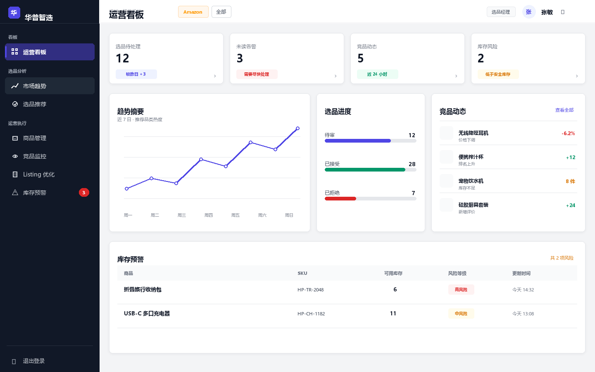
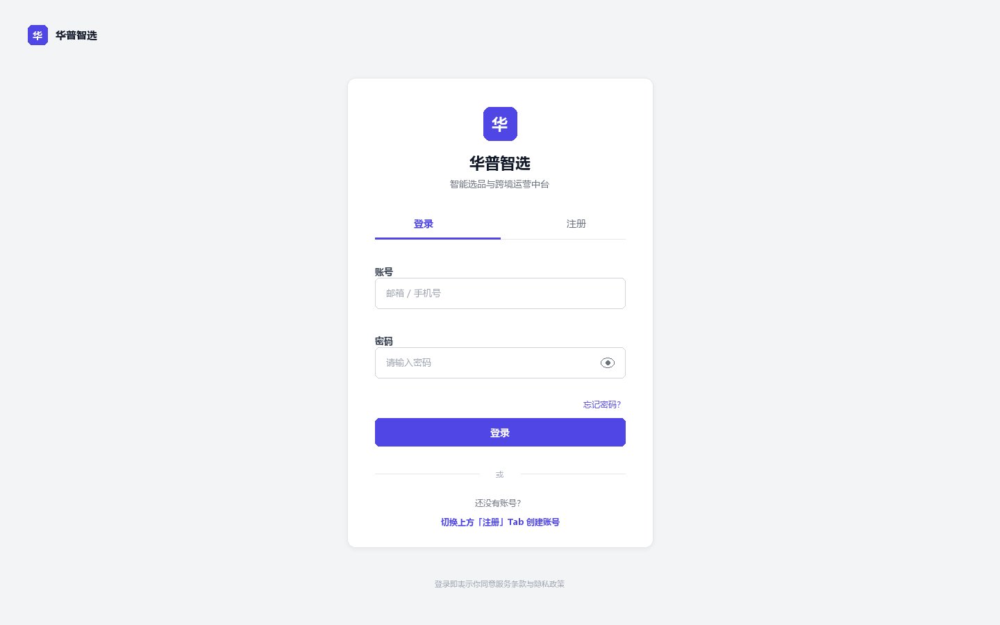
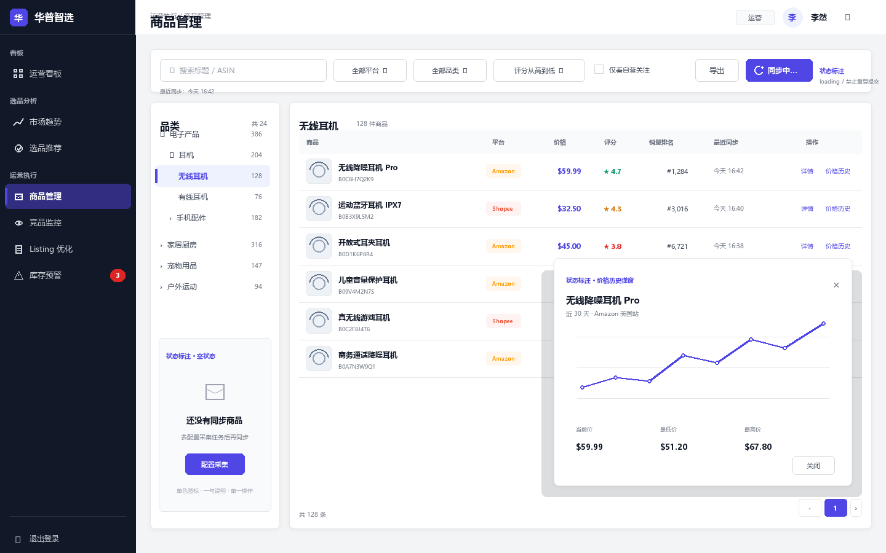
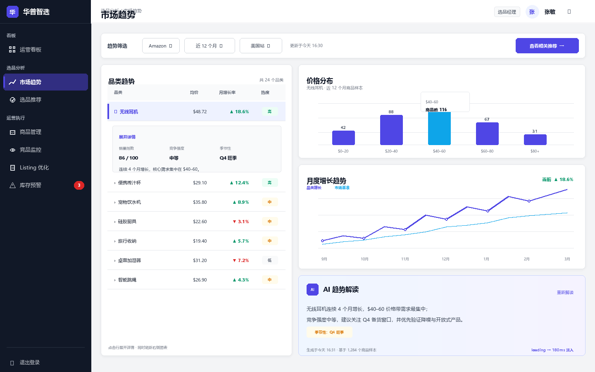

# 华普智选原型图索引

> 原型基准：桌面端 1440 × 900。视觉规范以 `../DESIGN.md` 为准，业务结构以 `../FLOWS.md` 为准。

## 全站骨架与入口页

| 编号 | 原型 | 图片 | 完整提示词 | 说明 |
|---|---|---|---|---|
| 00 | 全局布局壳 | [00-global-shell.png](./images/00-global-shell.png) | [00-global-shell.md](./prompts/00-global-shell.md) | 240px 深色侧栏、56px 顶栏用户区、运营看板内容占位 |
| 01 | 登录 / 注册 | [01-login.png](./images/01-login.png) | [01-login.md](./prompts/01-login.md) | 登录 / 注册 Tab、居中认证卡片、品牌区 |
| 02 | 商品管理 | [02-products.png](./images/02-products.png) | [02-products.md](./prompts/02-products.md) | 品类树、商品表格、同步/空状态/价格历史弹窗 |
| 03 | 市场趋势 | [03-trends.png](./images/03-trends.png) | [03-trends.md](./prompts/03-trends.md) | 40/60 双栏、价格分布、增长趋势、AI 解读 |

交互状态与动效说明见 [INTERACTION.md](./INTERACTION.md)。

## 预览

### 00 · 全局布局壳



### 01 · 登录 / 注册



### 02 · 商品管理



### 03 · 市场趋势



## 约束

- 主色 `#4F46E5`，侧栏 `#111827`，画布 `#F3F4F6`，内容面 `#FFFFFF`
- 使用 8px 间距网格与系统字体栈
- 禁止 AI 紫粉渐变、Inter 字体、玻璃拟态、霓虹光晕和营销式 Hero
- 登录页为 A0 独立入口，不套 AppShell

## 本地复现

在仓库根目录执行：

```powershell
python docs/prototypes/render_prototypes.py
```

脚本会覆盖生成 `images/00-global-shell.png`、`images/01-login.png`、`images/02-products.png` 与 `images/03-trends.png`。
